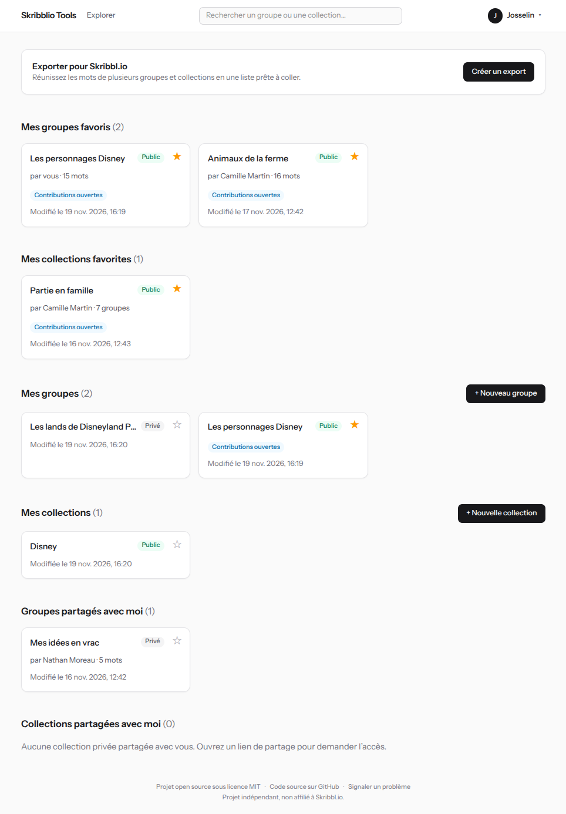
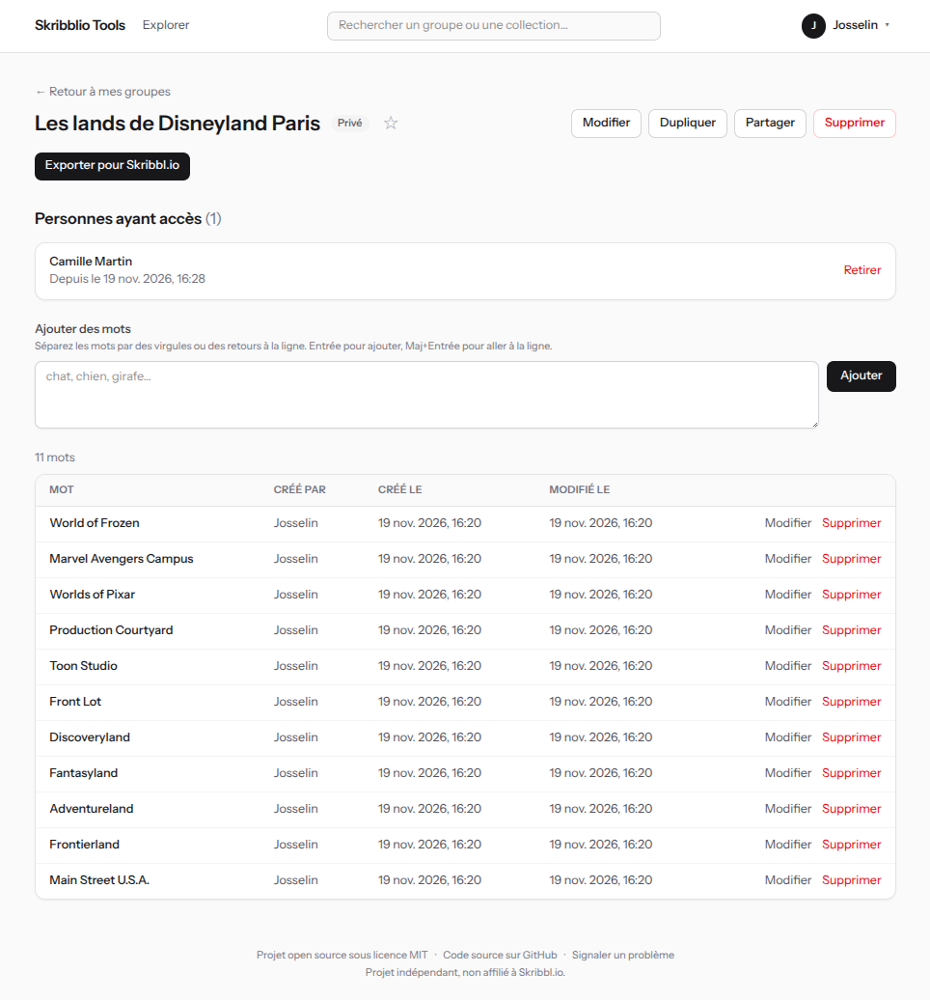
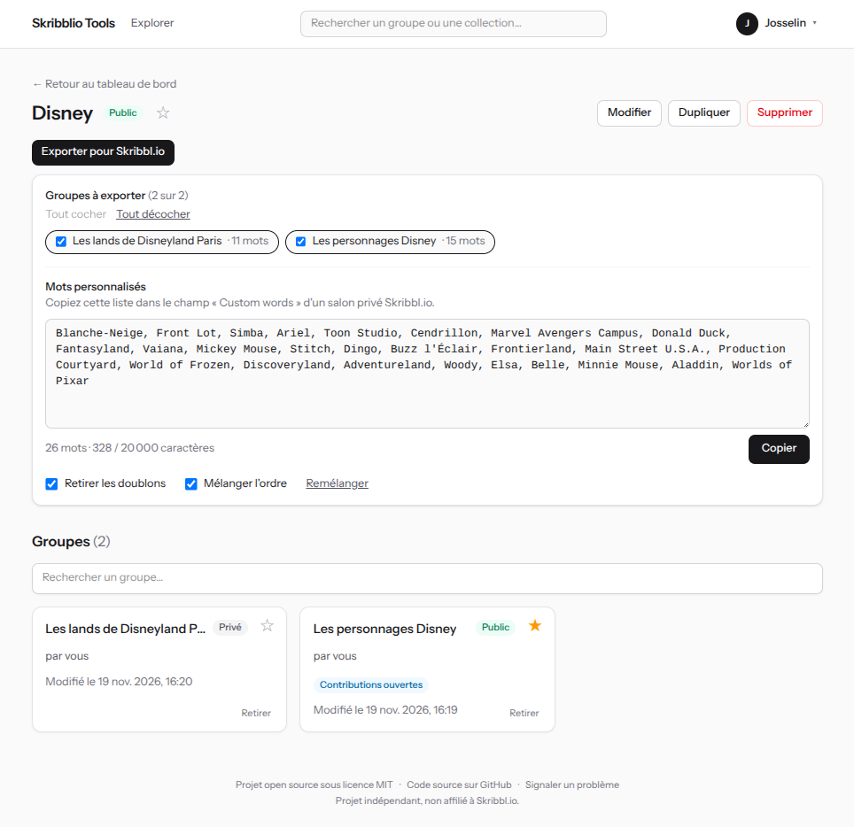
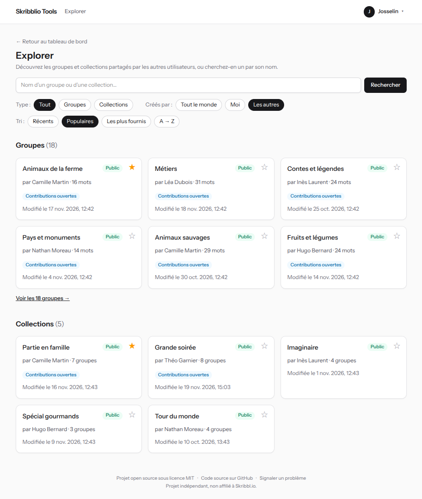

# Skribblio Tools

**Skribblio Tools** est une application web qui aide à préparer des parties de [Skribbl.io](https://skribbl.io).

Elle permet de constituer des listes de mots personnalisés, seul ou à plusieurs, puis de les exporter pour les utiliser directement comme mots personnalisés lors d'une partie Skribbl.io.

## Fonctionnalités

- Création de listes de mots personnalisés
- Édition des listes seul ou en collaboration avec d'autres utilisateurs
- Favoris : groupes et collections favoris sur le tableau de bord
- Partage des groupes et collections privés par lien de demande d'accès, avec validation par le créateur et notifications par e-mail
- Page de chaque utilisateur (en cliquant sur son nom) avec ses groupes et collections visibles
- Recherche par nom parmi ses groupes et collections et ceux, publics, des autres utilisateurs
- Export d'un groupe, d'une collection ou d'une sélection de plusieurs groupes et collections dans un format prêt à coller dans Skribbl.io

## Aperçu

### Tableau de bord

Les favoris, les groupes et collections de l'utilisateur, ceux qui sont partagés avec lui, et un accès direct à la création d'un export.



### Page d'un groupe

Ajout de mots en lot, liste des mots avec leur auteur, et gestion des personnes ayant accès à un groupe privé.



### Export pour Skribbl.io

Sur une collection, on choisit les groupes à exporter et on obtient une liste prête à coller dans le champ « Custom words » d'un salon privé, avec les compteurs de mots et de caractères et les options pour retirer les doublons ou mélanger l'ordre.



### Explorer

Pour découvrir les groupes et collections publics des autres utilisateurs, avec des filtres par type, par auteur et par tri.



## Stack technique

- [Laravel](https://laravel.com) 13 (PHP 8.5) : API JSON
- [Laravel Sanctum](https://laravel.com/docs/sanctum) (mode SPA) et [Laravel Fortify](https://laravel.com/docs/fortify) (sans vues) pour l'authentification
- [Vue 3](https://vuejs.org) + [TypeScript](https://www.typescriptlang.org), avec [Vue Router](https://router.vuejs.org), [Pinia](https://pinia.vuejs.org) et [axios](https://axios-http.com) : front-end (SPA)
- Vite et Tailwind CSS 4 pour le build et le style
- [Laravel Lang](https://laravel-lang.com) pour les traductions françaises
- [Laravel Sail](https://laravel.com/docs/sail) pour l'environnement de développement Docker
- MySQL 8.4 pour la base de données
- Redis pour le cache et les files d'attente (jobs)
- Mailpit pour intercepter les e-mails en local

## Architecture

L'application est découpée en deux parties qui vivent dans le même dépôt :

- **Le front-end** est une application monopage (SPA) Vue 3 écrite en TypeScript, dans `resources/js`. Toute l'interface est rendue côté navigateur ; Vue Router gère la navigation.
- **Le back-end** Laravel est une API JSON. Il ne génère pas de pages : pour n'importe quelle URL du front, il renvoie la même vue `resources/views/app.blade.php`, qui ne fait que charger la SPA.

```
Navigateur ──► Laravel sert app.blade.php ──► la SPA Vue démarre
     │
     └── appels axios ──► /login, /register… (Fortify)
                     └──► /api/...           (API de l'application)
```

### Accès à l'application

Tout est privé : pour voir quoi que ce soit, il faut être **inscrit, connecté et avoir validé son adresse e-mail** (elle sert à envoyer des notifications). Une fois connecté, l'utilisateur arrive sur `/dashboard`.

- Les routes de l'API (`routes/api.php`) sont protégées par les middlewares `auth:sanctum` et `verified`. Seule `GET /api/user` est accessible avant la validation de l'e-mail, pour que la SPA sache où rediriger l'utilisateur.
- Côté front, le routeur (`resources/js/router/index.ts`) fait les mêmes vérifications avant chaque page et redirige vers la connexion ou vers la page « confirmez votre e-mail ».

### Authentification

- **Sanctum en mode SPA** : l'authentification repose sur le cookie de session de Laravel et sa protection CSRF, pas sur des tokens. Le front et l'API partagent le même domaine.
- **Fortify** fournit les routes d'inscription, de connexion, de déconnexion, de mot de passe oublié et de validation d'e-mail. Ses vues sont désactivées : les écrans correspondants sont des pages Vue.
- Laravel génère des redirections et des liens dans les e-mails vers les routes nommées `login`, `dashboard`, `password.reset` et `verification.notice`. Elles sont donc déclarées dans `routes/web.php` et pointent vers la SPA.

### Base de données

Toutes les clés primaires sont des **UUID** (v7, triables) plutôt que des entiers auto-incrémentés : trait `HasUuids` sur les modèles, `uuid('id')->primary()` et `foreignUuid()` dans les migrations. Seules les tables techniques de Laravel `jobs`, `failed_jobs` et `personal_access_tokens` gardent un identifiant entier.

Les colonnes `created_at` et `updated_at` (dates de création et de dernière modification) sont présentes sur toutes les tables métier et ne sont pas répétées ci-dessous.

#### Tables métier

**`users`** : les comptes utilisateurs.

| Champ               | Type            | Description                                                                  |
| ------------------- | --------------- | ---------------------------------------------------------------------------- |
| `id`                | UUID            | Identifiant                                                                  |
| `name`              | chaîne          | Nom affiché (cartes « par X », auteur des mots, demandes d'accès)            |
| `email`             | chaîne, unique  | Adresse e-mail, utilisée pour la connexion et les notifications ; jamais exposée aux autres utilisateurs |
| `email_verified_at` | date, nullable  | Date de validation de l'adresse ; `null` tant qu'elle n'est pas validée (ou après un changement d'adresse) |
| `password`          | chaîne          | Mot de passe haché                                                           |
| `remember_token`    | chaîne, nullable| Jeton de la case « Se souvenir de moi »                                      |

**`word_groups`** : les groupes de mots.

| Champ                   | Type                  | Description                                                                      |
| ----------------------- | --------------------- | -------------------------------------------------------------------------------- |
| `id`                    | UUID                  | Identifiant                                                                      |
| `name`                  | chaîne                | Nom du groupe                                                                    |
| `visibility`            | chaîne                | `public` (visible par tous les utilisateurs connectés) ou `private` (créateur et membres) ; enum `App\Enums\Visibility` |
| `accepts_contributions` | booléen (`false`)     | Ouvert aux contributions : ceux qui voient le groupe peuvent y ajouter des mots et modifier les leurs |
| `contributions_members_only` | booléen (`false`) | Sur un groupe public ouvert aux contributions, seuls les membres (acceptés via le lien de partage) contribuent ; sans effet sur un groupe privé ou fermé |
| `share_token`           | chaîne(64), nullable, unique | Jeton secret du lien de partage (`/share/groups/{token}`), généré à la demande ; le régénérer invalide l'ancien lien. Jamais renvoyé par l'API en dehors du lien lui-même |
| `created_by`            | UUID → `users`        | Créateur ; le supprimer supprime le groupe                                       |

**`words`** : les mots, chacun dans un seul groupe.

| Champ           | Type                      | Description                                                                 |
| --------------- | ------------------------- | --------------------------------------------------------------------------- |
| `id`            | UUID                      | Identifiant                                                                 |
| `name`          | chaîne                    | Le mot : 32 caractères au plus, sans virgule ; unique dans son groupe (index unique `word_group_id` + `name`, qui ignore la casse et les accents) |
| `word_group_id` | UUID → `word_groups`      | Groupe du mot ; supprimer le groupe supprime ses mots                        |
| `created_by`    | UUID → `users`, nullable  | Auteur du mot ; passe à `null` (« Compte supprimé ») quand l'auteur supprime son compte, pour garder les mots ajoutés aux groupes des autres |

**`group_collections`** : les collections de groupes (modèle `GroupCollection`).

| Champ                   | Type                         | Description                                                             |
| ----------------------- | ---------------------------- | ----------------------------------------------------------------------- |
| `id`                    | UUID                         | Identifiant                                                             |
| `name`                  | chaîne                       | Nom de la collection                                                    |
| `visibility`            | chaîne                       | `public` ou `private`, comme pour les groupes                           |
| `accepts_contributions` | booléen (`false`)            | Ouverte aux contributions : ceux qui voient la collection peuvent y ajouter des groupes et retirer ceux qu'ils ont ajoutés |
| `contributions_members_only` | booléen (`false`)       | Comme pour les groupes : sur une collection publique ouverte, seuls ses membres contribuent |
| `share_token`           | chaîne(64), nullable, unique | Jeton secret du lien de partage (`/share/collections/{token}`)         |
| `created_by`            | UUID → `users`               | Créateur ; le supprimer supprime la collection                          |

**`groups_collections`** : table pivot entre collections et groupes (clé primaire composée `group_collection_id` + `word_group_id`).

| Champ                 | Type                       | Description                                                                 |
| --------------------- | -------------------------- | --------------------------------------------------------------------------- |
| `group_collection_id` | UUID → `group_collections` | Collection ; la supprimer retire la ligne mais pas le groupe                |
| `word_group_id`       | UUID → `word_groups`       | Groupe ; le supprimer le retire de toutes ses collections                   |
| `added_by`            | UUID → `users`, nullable   | Qui a ajouté le groupe à la collection (un contributeur peut retirer les groupes qu'il a ajoutés) ; `null` une fois ce compte supprimé |

La règle « une collection contient au moins un groupe » est appliquée par l'application, pas par la base.

#### Favoris

**`favorite_word_groups`** et **`favorite_group_collections`** : les groupes et collections mis en favori, avec une clé primaire composée (un même élément ne peut être favori qu'une fois par utilisateur).

| Champ                                    | Type                                       | Description                                       |
| ---------------------------------------- | ------------------------------------------ | ------------------------------------------------- |
| `user_id`                                | UUID → `users`                             | Utilisateur qui a mis l'élément en favori         |
| `word_group_id` / `group_collection_id`  | UUID → `word_groups` / `group_collections` | Élément mis en favori                             |
| `created_at`                             | date                                       | Date de mise en favori (tri des listes de favoris) |

#### Votes

**`word_votes`** : les pouces 👍 / 👎 donnés aux mots d'un groupe ouvert aux contributions, avec une clé primaire composée (un vote par mot et par utilisateur). Ils servent d'indicateur aux contributeurs et n'ont pas d'effet sur l'export.

| Champ        | Type           | Description                                   |
| ------------ | -------------- | --------------------------------------------- |
| `word_id`    | UUID → `words` | Mot noté (supprimé avec le mot)               |
| `user_id`    | UUID → `users` | Votant (supprimé avec son compte)             |
| `value`      | entier         | `1` pour 👍, `-1` pour 👎 (le score est la somme) |
| `created_at` | date           | Date du vote                                  |
| `updated_at` | date           | Date du dernier changement de vote            |

Supprimer l'utilisateur ou l'élément supprime le favori.

#### Partage des éléments privés

**`word_group_access_requests`** et **`group_collection_access_requests`** : les demandes d'accès envoyées depuis un lien de partage. Une seule ligne par élément et par demandeur (index unique) : redemander après un refus rouvre la même demande.

| Champ                                   | Type                                       | Description                                                                 |
| --------------------------------------- | ------------------------------------------ | --------------------------------------------------------------------------- |
| `id`                                    | UUID                                       | Identifiant                                                                 |
| `word_group_id` / `group_collection_id` | UUID → `word_groups` / `group_collections` | Élément demandé                                                             |
| `user_id`                               | UUID → `users`                             | Demandeur                                                                   |
| `status`                                | chaîne                                     | `pending` (en attente), `accepted` ou `refused` ; enum `App\Enums\AccessRequestStatus` |
| `decided_at`                            | date, nullable                             | Date à laquelle le créateur a accepté ou refusé                             |
| `via_group_collection_id`               | UUID → `group_collections`, nullable       | Groupes uniquement : collection depuis laquelle la demande a été faite (« demander l'accès aux groupes masqués »). Le demandeur ne connaît pas le nom du groupe, qui ne doit pas lui être révélé ; passe à `null` si la collection est supprimée |

**`word_group_members`** et **`group_collection_members`** : les personnes dont la demande a été acceptée (clé primaire composée élément + utilisateur). Un membre voit l'élément privé, ou contribue à l'élément public réservé à ses membres ; le créateur peut lui retirer l'accès en supprimant la ligne.

| Champ                                   | Type                                       | Description                    |
| --------------------------------------- | ------------------------------------------ | ------------------------------ |
| `word_group_id` / `group_collection_id` | UUID → `word_groups` / `group_collections` | Élément partagé                |
| `user_id`                               | UUID → `users`                             | Membre                         |
| `created_at`                            | date                                       | Date à laquelle l'accès a été accordé |

#### Tables techniques de Laravel

| Table                    | Rôle                                                                                         |
| ------------------------ | -------------------------------------------------------------------------------------------- |
| `sessions`               | Sessions des utilisateurs (`SESSION_DRIVER=database`), sur lesquelles repose l'authentification Sanctum : `id`, `user_id` (nullable), `ip_address`, `user_agent`, `payload` (données sérialisées), `last_activity` (timestamp Unix) |
| `password_reset_tokens`  | Jetons de « mot de passe oublié » : `email` (clé primaire), `token` (haché), `created_at`     |
| `personal_access_tokens` | Tokens d'API Sanctum (`tokenable_type` / `tokenable_id`, `name`, `token`, `abilities`, `last_used_at`, `expires_at`). Non utilisés par la SPA, qui s'authentifie par cookie ; vidés à la suppression d'un compte |
| `cache`, `cache_locks`   | Cache et verrous en base (`key`, `value` / `owner`, `expiration`), inutilisés tant que `CACHE_STORE=redis` |
| `jobs`, `job_batches`    | File d'attente en base, inutilisée tant que `QUEUE_CONNECTION=redis`                         |
| `failed_jobs`            | Jobs en échec (`uuid`, `connection`, `queue`, `payload`, `exception`, `failed_at`), à relancer avec `artisan queue:retry` |

### Modèle de données

```
User ──crée──► Word, WordGroup, GroupCollection

WordGroup 1 ──── n Word              un mot appartient à un seul groupe
GroupCollection n ──── n WordGroup   table pivot groups_collections
User n ──── n WordGroup              favoris : favorite_word_groups
User n ──── n GroupCollection        favoris : favorite_group_collections
User n ──── n WordGroup              membres : word_group_members
User n ──── n GroupCollection        membres : group_collection_members
User n ──── n Word                   votes : word_votes
```

- **Mot** (`words`) : un nom, unique dans son groupe (sans tenir compte des majuscules ni des accents), de 32 caractères au plus et sans virgule (règles de Skribbl.io). Un mot n'a pas de visibilité propre : il est visible par ceux qui voient son groupe.
- **Groupe** (`word_groups`) et **collection** (`group_collections`, modèle `GroupCollection`) : un nom, une visibilité, `public` (visible par tous les utilisateurs connectés) ou `private` (visible par son créateur et les personnes à qui il a donné accès), et l'option « Ouvert aux contributions » (désactivée par défaut).
- Une collection contient **au moins un groupe**. Un groupe peut appartenir à plusieurs collections. Seule exception : supprimer un groupe le retire de toutes ses collections, même s'il en était le dernier ; la page de la collection indique alors qu'elle est vide.

Règles d'accès (définies dans `app/Policies`) :

- Seul le créateur peut renommer un groupe ou une collection, changer sa visibilité, ouvrir ou fermer les contributions, et le supprimer.
- **Contributions** : le créateur gère toujours le contenu. Tant qu'un groupe est ouvert aux contributions, tous ceux qui le voient peuvent y ajouter des mots et modifier ou supprimer les leurs. Tant qu'une collection est ouverte, tous ceux qui la voient peuvent y ajouter des groupes et retirer ceux qu'ils ont ajoutés. Une fois fermé, seul le créateur modifie le contenu ; les contributions déjà faites sont conservées, et rouvrir rend leurs droits aux contributeurs.
- **Contributions sur autorisation** : un groupe ou une collection public peut être ouvert aux contributions des seules personnes que le créateur autorise. Tout le monde le consulte et peut voter, mais pour contribuer il faut demander l'autorisation via le lien de partage, comme pour un élément privé. Retirer l'autorisation conserve les contributions déjà faites ; rendre l'élément privé fait de ces personnes des membres qui le voient.
- Ajouter, renommer ou supprimer un mot met à jour la date de modification du groupe ; ajouter ou retirer un groupe met à jour celle de la collection.
- Un groupe ou une collection privé auquel on n'a pas accès répond « introuvable » (404), pour ne pas révéler son existence.
- Qui peut ajouter des groupes à une collection peut y ajouter tout groupe qu'il voit : ses propres groupes (même privés) et les groupes publics des autres. On ne peut pas retirer le dernier groupe d'une collection.
- Une collection publique peut contenir des groupes privés. Les autres utilisateurs ne les voient pas, mais un message leur indique que certains groupes leur sont masqués, et ils peuvent en demander l'accès.
- Tous ceux qui voient un groupe ou une collection peuvent le **dupliquer** : la copie (« … (copie) ») leur appartient, est privée, fermée aux contributions et sans lien avec l'original. Pour une collection, chaque groupe visible est copié, sauf les groupes de l'utilisateur, repris tels quels ; les groupes masqués ne sont pas copiés.
- On peut mettre en favori tout groupe ou toute collection que l'on peut voir. Les favoris sont listés sur le tableau de bord. Si un favori devient inaccessible, il y reste affiché mais grisé et non cliquable ; on peut toujours le retirer des favoris.
- Supprimer son compte supprime tout ce qu'on a créé, sauf les mots ajoutés aux groupes des autres, qui restent sans auteur (« Compte supprimé »). Supprimer un groupe supprime ses mots et le retire des collections. Supprimer une collection ne supprime pas ses groupes.

### Export pour Skribbl.io

Sur la page d'un groupe ou d'une collection, le bouton « Exporter pour Skribbl.io » affiche tous les mots séparés par des virgules, prêts à coller dans le champ « Custom words » d'un salon privé. Tous ceux qui voient le groupe ou la collection peuvent l'exporter ; pour une collection, seuls les groupes visibles sont inclus.

- Skribbl.io demande au moins 10 mots, de 32 caractères au plus, pour 20 000 caractères au total : le panneau compte les mots et les caractères et avertit quand une limite n'est pas respectée.
- Options : retirer les doublons (activé par défaut, sans tenir compte des majuscules), mélanger l'ordre, et tirer au hasard une sélection qui tient dans la limite de caractères.
- Sur une collection, on peut décocher certains de ses groupes avant l'export (tous sont cochés par défaut).
- Depuis le tableau de bord, « Créer un export » permet de constituer une sélection de groupes : on les ajoute un par un, ou tous les groupes visibles d'une collection d'un coup, et on peut en retirer. Leurs mots sont réunis dans une seule liste. La sélection peut ensuite être enregistrée comme nouvelle collection, qui ne suit pas les changements ultérieurs. Rien n'est enregistré tant qu'on ne crée pas la collection.
- L'API (`GET /api/word-groups/{id}/export` et `GET /api/group-collections/{id}/export`, qui renvoie les mots groupe par groupe) fournit la liste brute des mots ; la combinaison des groupes, le dédoublonnage, le mélange et la mise en forme se font dans le front (`resources/js/lib/skribbl.ts`).

### Partage des groupes et collections privés

1. Sur un groupe ou une collection **privé** (ou public avec contributions sur autorisation : le lien sert alors à demander à contribuer), le créateur clique sur « Inviter » et copie le lien (`/share/…`). Il peut régénérer ce lien : l'ancien ne fonctionne alors plus.
2. La personne qui ouvre le lien (après connexion ou inscription) envoie une demande d'accès. Le créateur est prévenu par e-mail.
3. Le créateur accepte (après confirmation) ou refuse la demande depuis la page de l'élément ou son tableau de bord. Le demandeur est prévenu par e-mail. Le créateur peut retirer un accès à tout moment.

Règles :

- Une personne autorisée sur un groupe privé peut le voir et y ajouter des mots.
- Une personne autorisée sur une collection privée voit aussi les groupes privés qu'elle contient, **mais uniquement ceux du créateur de la collection** : partager une collection ne donne jamais accès aux groupes d'autres personnes. Être autorisé à contribuer à une collection publique ne donne pas accès à ses groupes privés.
- Sur une collection, un bouton permet de demander en une fois l'accès à tous les groupes privés masqués ; leurs noms ne sont pas révélés au demandeur.
- Les e-mails partent par la file d'attente : lancez `./vendor/bin/sail artisan queue:work` en local.

### Organisation du front-end

| Dossier                    | Contenu                                                              |
| -------------------------- | -------------------------------------------------------------------- |
| `resources/js/pages`       | Les pages, une par route (`pages/auth` pour l'authentification)      |
| `resources/js/components`  | Les composants réutilisables (champs de formulaire, boutons…)        |
| `resources/js/api`         | Les fonctions d'appel à l'API, un fichier par ressource (`wordGroups.ts`…) |
| `resources/js/stores`      | Les stores Pinia (utilisateur connecté et actions d'authentification) |
| `resources/js/composables` | La logique réutilisable, dont `useForm` pour les formulaires          |
| `resources/js/router`      | Les routes et leurs protections (`requiresVerified`, `guestOnly`…)    |
| `resources/js/lib`         | Le client HTTP partagé (axios configuré pour Sanctum)                 |
| `resources/js/types`       | Les types TypeScript qui reflètent les réponses de l'API             |

Chaque réponse de l'API passe par une API Resource Laravel (`app/Http/Resources`) et a son interface TypeScript équivalente dans `resources/js/types`.

### Traductions

L'application est en français (`APP_LOCALE=fr`). Les traductions de Laravel (validation, e-mails, mots de passe…) sont dans `lang/` ; elles proviennent de Laravel Lang et se mettent à jour avec `./vendor/bin/sail artisan lang:update`.

## Démarrer le projet avec Sail

### Prérequis

- [Docker](https://docs.docker.com/get-docker/) avec Docker Compose
- Git

PHP, Composer et Node n'ont pas besoin d'être installés sur votre machine : tout tourne dans les conteneurs Sail.

### Installation

1. Cloner le dépôt :

   ```sh
   git clone git@github.com:josselinh/skribblio.git
   cd skribblio
   ```

2. Créer le fichier d'environnement :

   ```sh
   cp .env.example .env
   ```

3. Installer les dépendances PHP (Sail n'est pas encore disponible à cette étape, on passe donc par un conteneur Composer) :

   ```sh
   docker run --rm \
       -u "$(id -u):$(id -g)" \
       -v "$(pwd):/var/www/html" \
       -w /var/www/html \
       laravelsail/php84-composer:latest \
       composer install --ignore-platform-reqs
   ```

   Il n'existe pas encore d'image `laravelsail/php85-composer` : celle de PHP 8.4 suffit pour installer les dépendances. L'application tourne bien en PHP 8.5 dans le conteneur Sail.

4. Construire l'image de l'application, puis démarrer les conteneurs :

   ```sh
   ./vendor/bin/sail build
   ./vendor/bin/sail up -d
   ```

   L'image `sail-8.5/app` n'est publiée sur aucun registre : elle est construite localement à partir de `vendor/laravel/sail/runtimes/8.5`. Sans `sail build`, `sail up -d` tente d'abord de la télécharger et affiche `failed to resolve reference "sail-8.5/app:latest"`. Le premier build prend une dizaine de minutes. Relancez `./vendor/bin/sail build` après une mise à jour de `laravel/sail`.

5. Générer la clé de l'application et créer les tables :

   ```sh
   ./vendor/bin/sail artisan key:generate
   ./vendor/bin/sail artisan migrate
   ```

6. Installer les dépendances front-end et lancer Vite :

   ```sh
   ./vendor/bin/sail npm install
   ./vendor/bin/sail npm run dev
   ```

   `npm run dev` reste au premier plan : laissez ce terminal ouvert tant que vous travaillez sur l'application. Pour se passer du serveur Vite, compilez une fois le front-end avec `./vendor/bin/sail npm run build` (et supprimez `public/hot` s'il existe).

L'application est alors accessible sur <http://localhost:8000>.

### Dépannage

#### Le build échoue sur `packages.sury.org`

Si `./vendor/bin/sail build` s'arrête avec :

```text
E: Failed to fetch https://packages.sury.org/php/dists/noble/main/binary-amd64/Packages.gz  File has unexpected size (… != …). Mirror sync in progress?
```

le problème ne vient pas du projet : le dépôt PHP utilisé par le Dockerfile de Sail est en cours de mise à jour et son CDN sert un index et des fichiers de versions différentes. Relancez `./vendor/bin/sail build` plus tard.

Si l'erreur persiste plusieurs heures, construisez l'image à partir d'une copie du runtime qui passe par le PPA Launchpad `ondrej/php` (même mainteneur, mêmes paquets), sans modifier `vendor/` :

```sh
cp -r vendor/laravel/sail/runtimes/8.5 /tmp/sail-runtime-8.5
sed -i \
    -e '/debsuryorg-archive-keyring.deb/d' \
    -e 's#&& echo "deb \[signed-by=/usr/share/keyrings/debsuryorg-archive-keyring.gpg\] https://packages.sury.org/php/ noble main" > /etc/apt/sources.list.d/php.list#\&\& curl -sS "https://keyserver.ubuntu.com/pks/lookup?op=get\&search=0x14AA40EC0831756756D7F66C4F4EA0AAE5267A6C" | gpg --dearmor > /etc/apt/keyrings/ppa_ondrej_php.gpg \&\& echo "deb [signed-by=/etc/apt/keyrings/ppa_ondrej_php.gpg] https://ppa.launchpadcontent.net/ondrej/php/ubuntu noble main" > /etc/apt/sources.list.d/ppa_ondrej_php.list#' \
    /tmp/sail-runtime-8.5/Dockerfile
docker build -t sail-8.5/app \
    --build-arg WWWGROUP="$(id -g)" \
    /tmp/sail-runtime-8.5
```

Puis reprenez à `./vendor/bin/sail up -d`.

### Traiter les jobs

Les jobs sont placés dans une file Redis. Pour qu'ils soient exécutés, lancez un worker dans un terminal dédié :

```sh
./vendor/bin/sail artisan queue:work
```

### Services disponibles

| Service             | URL / port                  |
| ------------------- | --------------------------- |
| Application         | <http://localhost:8000>     |
| Vite (dev server)   | <http://localhost:5173>     |
| Mailpit (web)       | <http://localhost:8025>     |
| MySQL               | `localhost:3306`            |
| Redis               | `localhost:6379`            |

Les ports sont modifiables dans le fichier `.env` (`APP_PORT`, `VITE_PORT`, `FORWARD_DB_PORT`, `FORWARD_REDIS_PORT`, `FORWARD_MAILPIT_DASHBOARD_PORT`).

### Commandes utiles

```sh
./vendor/bin/sail up -d            # Démarrer les conteneurs
./vendor/bin/sail stop             # Arrêter les conteneurs
./vendor/bin/sail artisan test     # Lancer les tests
./vendor/bin/sail bin pint         # Formater le code PHP
./vendor/bin/sail npm run type-check  # Vérifier les types TypeScript
./vendor/bin/sail npm run build    # Vérifier les types puis compiler le front-end
./vendor/bin/sail shell            # Ouvrir un shell dans le conteneur
```

Astuce : ajoutez un alias pour taper simplement `sail` au lieu de `./vendor/bin/sail` :

```sh
alias sail='sh $([ -f sail ] && echo sail || echo vendor/bin/sail)'
```

## Licence

Skribblio Tools est un logiciel libre distribué sous [licence MIT](LICENSE). Projet indépendant, non affilié à Skribbl.io.
